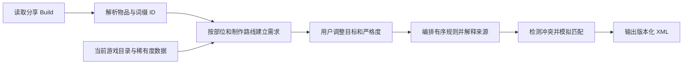

# 从 Build 生成最后纪元过滤器的研究

研究日期：2026 年 10 月 16 日。游戏基准为 **1.5.2.1，内部版本 1.5.2.2**，构建哈希 `8dfd6929fe2d10f2e77b7ed4c8e6910f49b2736b`。参考过滤器为用户提供的 `流血骷髅游荡者S5.xml`，其头部记录 `1.4.7 / lootFilterVersion 9`。

可以直接从 LastEpochTools 分享数据提取目标物品和词缀，再结合当前游戏目录生成过滤器。设计的关键是把毕业配装转换为**成品、可加工底材、传奇合成材料、神像组合和碎片来源**，而不是只筛与毕业装备完全相同的掉落。

当前研究已取得逐项词缀权重和暗金稀有度相关字段，并核对过滤器的主要匹配行为。精确的全局掉率、自动判断全部有效替代词缀，以及游戏内导入验收，仍是不同层次的工作，不能由这些字段直接替代。

## 项目资料与交付数据

开始研究时当前工作区没有 `docs/`。已阅读 `.local/research/docs-draft/` 的索引及 01 至 10 篇草稿，同时对照根 README、`tools/README.md` 和现有代码。草稿描述了另一代码基准的五步工作流；实现入口以当前文件为准。本次新增此研究文档，不搬运或覆盖那些草稿。

| 文件 | 用途 |
| --- | --- |
| [稀有度数据](data/filter-rarity-data.json) | 每个词缀及独特物品的权重、来源限制和潜能相关事实 |
| [词缀稀有度表](data/filter-affix-rarity.csv) | 可用表格软件查看的逐词缀目录 |
| [暗金与套装稀有度表](data/filter-unique-rarity.csv) | 可用表格软件查看的逐物品目录 |
| [公开 Build 需求样例](data/build-requirements-om6w3Ypq.json) | 已有公开 fixture 的按部位目标及神像组合，供后续开发核对 |
| [稀有度提取工具](../tools/extract-filter-rarity.py) | 从既有本地游戏提取结果重建稀有度目录 |
| [现有分享接口](../web/src/core/planner.js) | 读取与规范化 LastEpochTools Build |
| [现有物品解析](../web/src/core/items.js) | 解码并验证物品和词缀身份 |

当前实现改为价值池驱动的四步流程：确认需求暗金、确认高价值词缀、勾选中价值词缀、自动分组与导出。下文关于做装、供体和拆解的研究仍作为机制背景，已不再要求用户逐条配置这些用途。LESaveEditor 保留原浅色五步存档界面，过滤器 CSS 限定在自身作用域。没有改写游戏内原过滤器，游戏内导入验收仍待进行。

本地化现已联接同版本官方简中和英文字符串表：全部 1,156 个词缀、489 个独特物品均有中文名称。稀有度 JSON 保留原始英文 `name` 并增加 `localizedName:{zh,en}`；两份 CSV 增加 `nameZh` 和 `nameEn`。前端目录 `web/src/data/filter-catalog.json` 使用按 ID 索引的 `name:{zh,en}`。不存在的中文标签回退英文，不以猜译替代；只有未使用的类型／底材占位缺少中文。

## 当前价值池与评分分组

新入口实现在 `core/value-filter.js`，复用同版本目录与已核验的物品身份解析。原 `core/loot-filter.js` 的逐行生成接口保留为底层研究与兼容测试，产品界面使用新流程。

**需求物品。** Build 暗金按 unique ID 去重，与用户增补的暗金合成一个“需求暗金”逻辑组。套装通过目录 `isSetItem` 分离，Build 需要及用户添加的套装纳入高价值套装。显示多个同名规则不代表多个用户需求组：同组可能需要多条原生条件实现。

**词缀价值。** 装备明确的附加词缀形成高价值池；`ir`、`ur` 固有 Roll 不加入。不能仅按字段名区分固有属性：固定暗金变体可能位于 `affixes` 或 `sealedAffix`，必须结合 `specificAffixIds` 和词缀类别排除。普通装备的封印与原初目标也保留词缀身份，阶级判断采用实际掉落词缀。普通装备之外的神像维护自己的形状与需求词缀集合。

`filter-common-affixes.json` 提供经过逐项核对的中价值默认清单，共 8 类、46 个普通装备词缀：生命与恢复、耐伤、护盾、属性、抗性、护甲、躲避／格挡／减伤、魔力与机动。默认全部选中，高价值优先去重；用户可删改。它是可编辑的通用候选，并不声称每项都适合所有流派。未选的其他装备词缀隐式归入低价值，不向用户展示全目录。

**装备评分。** `draft.scoring` 保存三类词缀 T1–T7 的独立分数，界面按 T7–T1 展示。默认值如下：

| 类别 | T7 | T6 | T5 | T4 | T3 | T2 | T1 |
| --- | ---: | ---: | ---: | ---: | ---: | ---: | ---: |
| 高价值 | 10 | 5 | 2 | 1.6 | 1.2 | 0.8 | 0.4 |
| 有效 | 4 | 2 | 1 | 0.8 | 0.6 | 0.4 | 0.2 |
| 无效 | 2 | 1 | 0 | -0.2 | -0.2 | -0.2 | -0.2 |

总分直接累加每条附加词缀的对应分数。空槽不加减分；封印、腐化、原初额外词缀也计入，T8 使用 T7 分数。高价值池优先于有效池，剩余装备词缀使用无效行。支持负数、非单调表和最多两位小数，内部使用百分之一分的整数单位避免浮点边界误差。旧统一扣分开关与分段百分比锚点已移除。100% 固定为当前 4 条高价值 T7 的总分，默认 40 分；门槛在 1–100% 线性换算，高价值 T7 须大于零。换算得到不足百分之一分的门槛时，比较边界向上取整，不降低门槛。

用户可添加、改名、删除或停用装备组，每组独立设置百分比门槛和显示样式。默认门槛为 100%、70%、45%；启用组按门槛降序匹配，同门槛保持添加顺序。停用不导出该组，设置保留；隐藏则导出终止匹配的 HIDE。未匹配分数组的装备继续按“至少一条 T7+ 或两条 T6+”的额外崇高组、其他装备组处理。

**评分编译。** 游戏没有加权分数字段，生成器需要将评分展开为原生条件；多个条件为 AND，多个有序规则表达分支。原生单条阶级比较支持 EQUAL、LESS、LESS_OR_EQUAL、MORE、MORE_OR_EQUAL、ANY，总阶条件统计通过词缀 ID 与单阶比较的条目。不能将空词缀集合用作空池（游戏视为全部词缀），也不能依赖零条词缀条件（编辑器会改写）。用户已允许保守近似。生成器优先尝试精确的分值桶计数决策树，超出游戏上限 200 条或出现原生编辑器不能保留的计数时，向分支内可能的最高优先级组合并，而不是截断规则。被合并的装备可能提前进入更高门槛的显示组；界面与导出诊断明确标注近似。所有真实达标的装备仍应获得不低于预期的显示优先级。若存在启用的隐藏评分组且需要近似，明确拒绝，防止误提升到 HIDE。额外崇高、其他装备、神像、暗金、套装与材料分组仍使用其原始条件。

编译器最多计入 4 条普通词缀加封印／腐化／原初，共 7 条。以十进制整数分值构造决策树并缓存结果；按剩余规则预算剪枝，同时避免输出会被原生编辑器夹取的计数。独立 XML 匹配测试分别验证精确配置完全一致、近似配置只提升不漏留，以及总规则不超过 200。

此评分用于捡取筛选，不代表实际 DPS、毕业程度或相对当前装备的真实提升。XML 结构及独立匹配测试验证导出与评分一致，游戏内导入仍待验收。

**神像。** 同一形状内合并用户选择的词缀，区分前后缀均符合、仅一类符合与其他；不将普通装备阶级门槛套在神像上。不继续要求与原 Build 中某一件神像完全相同的配对，允许同形状目标词缀重组。

**暗金与套装。** 顺序为需求暗金、相对稀有暗金、高潜暗金（LP 2–4）、一般暗金；套装分高价值与一般。随机池暗金默认重抽参数门槛为 0.9，套装独立使用 0.65；当前数据分别按原始精度比较，避免以显示为 0.7 的 float32 数值误判。套装 0.65 门槛得到 8 个随机池候选；用户需要的套装独立并入。定向掉落缺少概率时不假定为稀有，Weaver 属性不冒充 LP。

**资源与显示。** 雕文、符文、碎片、钥匙及祭坛独立于普通装备兜底。每个逻辑组可改显示／隐藏、颜色和强调；隐藏导出为相同条件的 HIDE，命中即停止，避免被后面的一般组重新显示。规则使用游戏 v9 序列化与优先级排序，网页预览和 XML 共用这些条件。未知目标阻止严格隐藏。

## 做装机制如何影响过滤需求

### 普通装备和崇高装备

普通装备的可变词缀通常分为两个前缀和两个后缀，底材自带属性另算。普通碎片升级止于 T5；T6、T7 是需要获得的崇高层级。**层级与层级内数值 Roll 是不同维度**。过滤器应优先寻找核心高阶词缀，再看其他有用词缀和锻造潜能，不应一开始要求四条毕业词缀全部齐全。[词缀指南](https://www.lastepochtools.com/guide/section/affixes)

锻造消耗 Forging Potential；它影响继续加工的空间。封印词缀会腾出普通词缀槽，但自身不能再按普通方式修改。稀有词缀装备也可以用于获取碎片：粉碎与移除的收益机制不同，不能把一件带稀有词缀的装备直接视为保证获得该碎片。用于穿戴的底材规则与用于拆解的规则应分开。[官方锻造机制说明](https://forum.lastepoch.com/t/crafting-changes-coming-to-eternal-legends-update-0-8-4/45597)

还需考虑能改变加工路线的材料：Havoc 可重排未封印词缀的层级，Redemption 可重新随机崇高词缀。因此，“有用词缀尚未达到 T7，但装备上另有 T7”可以成为另一类做装底材，而非直接丢弃。是否保留这类底材应由用户的材料预算与严格度决定。[官方后期做装说明](https://forum.lastepoch.com/t/endgame-balance-and-itemization-updates-coming-to-last-epoch-april-17th/75189)

T8 属于原初机制：Evolution 可把 T7 提升为封印 T8；这不是普通碎片继续升级的结果。Build 指定 T8 时，应同时识别其 T7 前身需求。不能因为数据中存在八个 tier，就生成“自然掉落普通 T8 成品”作为唯一获取路线。[官方 1.3 原初物品说明](https://forum.lastepoch.com/t/last-epoch-beneath-ancient-skies-patch-notes/78635/2)

### 暗金和传奇材料

普通传奇合成使用带 LP 的暗金与相同物品类型的崇高装备。材料需要四条未封印词缀；有封印词缀并不自动使材料无效，但封印词缀不转移。材料底材子类型不必与暗金相同。已腐化装备不能走这条合成路线。[传奇物品指南](https://www.lastepochtools.com/guide/section/legendary_items)

自 1.2 起，T2 及以上时空圣殿可以指定一条保证转移的词缀，且存在合成暴击。过滤器无需把所有材料都限制为四条完美词缀；应让用户选择“单条核心材料”和“多条有用材料”的严格度。[官方 1.2 永恒宝箱调整](https://forum.lastepoch.com/t/last-epoch-tombs-of-the-erased-patch-notes/75247/2)

例如，目标暗金头盔附加 `408/T7`，需求应拆成：保留该暗金头盔，以及保留能提供 `408/T7` 的适用崇高头盔。不能要求地上暗金已经带有这一传奇词缀，也不能让靴子上的其他目标词缀满足这条材料规则。

### 神像和特殊路线

| 目标类型 | 应寻找什么 | 不能直接套用的规则 |
| --- | --- | --- |
| 普通神像 | 对应形状、职业与前后缀组合 | 普通神像词缀通常为 T1，不能按装备 T6 门槛筛选 |
| 附魔神像 | 普通词缀合适的神像前身，附魔目标另外记录 | 不要求前身掉落时已经拥有全部附魔词缀 |
| Weaver 神像 | 保留目标形状和组合，也可额外保留同类重铸底材 | 不等同 Weaver's Will 独特装备；不能仅凭 cannotDrop 标志排除特殊来源 |
| Weaver 装备 | 正确独特身份及适当 Weaver's Will；附加词缀作为养成目标 | 不能把它的全部目标词缀转换为永恒宝箱材料 |
| 实验词缀 | 对应实验物品，或适合实验制作的底材 | 不生成普通碎片拆解需求；实验词缀没有普通碎片 |
| 套装与重铸套装 | 目标套装，或其重铸词缀与适用底材 | 套装不按普通 LP 暗金处理 |
| 腐化目标 | 能穿戴的目标结果，以及适用的未腐化制作前身 | 腐化品不能当成可继续普通加工的底材 |
| 神像祭坛 | 独立类型、底材布局、祭坛词缀 | 不与九种普通神像形状混为一类 |

附魔神像、实验制作和重铸套装各有专用获取途径；应通过词缀类别和物品类别区分，不能把所有出现在模拟器里的词缀都当作常规掉落词缀。[官方特殊制作说明](https://forum.lastepoch.com/t/last-epoch-tombs-of-the-erased-patch-notes/75247/2)

Weaver 神像具有独立词缀池，并有获取渠道；它与附魔后的 Heretical 神像是两种机制。织网者阶级解锁后可以重铸职业神像或 Weaver 神像，后者重铸仍至少含一条 Weaver 词缀。因此神像也可以区分目标组合与重铸材料。[官方 Weaver 神像说明](https://forum.lastepoch.com/t/the-woven-faction-monolith-updates-coming-to-last-epoch-april-17th/75147)、[官方重铸规则](https://forum.lastepoch.com/t/last-epoch-beneath-ancient-skies-patch-notes/78635/6)

1.4 的腐化和 Omen 神像、祭坛进一步扩大了这种差别：腐化是终止一般加工的状态，Omen 神像本身就是腐化掉落。[官方 1.4 新物品机制](https://forum.lastepoch.com/t/last-epoch-shattered-omens-patch-notes/80571/2)

S5 还新增 Blood / Ice Forging Potential，分别影响锻造暴击或潜能消耗。当前过滤条件能比较 FP 数量，不能区分这两种类型；不能在导出选项中承诺按冰或血潜能过滤。[官方 S5 说明](https://lastepoch.com/1-5/patchnotes#rage-of-morditas)

## 从 Build 提取需求

### 读取与身份映射

复用现有 `parsePlannerUrl()`、`fetchPlannerBuild()` 和 `normalizePlannerBuild()`，得到 `{ id, sourceUrl, dataVersion, data }`。公开接口为 `https://www.lastepochtools.com/api/public/build_data/<分享码>`；它是已使用的接口，不具有已知的稳定版本契约。

直接分析 Build，不必上传存档，也不要先调用存档编码器。编码器生成的随机身份、交易标志、FP 和保存限制不属于过滤需求。

| Build 字段 | 分析用途 |
| --- | --- |
| `data.bio` | 职业、专精、等级；目标等级不等于用户当前刷装等级 |
| `data.equipment[slot].id` | 按部位提取普通底材或独特物品身份 |
| `affixes[]`、`sealedAffix`、`corruptedAffix` | 目标词缀 ID、tier、Roll 和特殊来源 |
| `lp` / `legendaryPotential`、`ww`、`wt` | LP、Weaver's Will、Weaver's Touch 目标，不能混为一种潜能 |
| `ir[]`、`ur[]` | 底材隐含与独特属性 Roll，不是普通词缀 ID |
| `data.idols[]` | 神像形状、组合和数量；坐标用于布局，不是地上物品条件 |
| `data.equipment.idol_altar` | 祭坛目标及布局依赖 |
| 天赋、技能、祝福、条件和增益 | 后续判断替代词缀的上下文 |

现有 `resolvePlannerItemId()` 已能解析 `I` 与 `U`；`A` 词缀 ID 也采用去前缀后的 LZ-string 解压。必须再联接当前目录。**`U` 不是“普通暗金”标签**，其中包含套装、Weaver 和原初暗金。

身份合法还不代表能够普通掉落。底材应补读原始 `cannotDrop`、`obsoleteItem`、`isLegacySubType`、`hideSubTypeInLootFilter` 等字段。Build 未指定某个特殊状态时应保留“未指定”，不能据此断言游戏中不具备该状态。

职业编码也必须显式转换：例如侍祭在 `bio.characterClass` 中是 3，在词缀 `ClassSpecificity` 位标记中是 16，在底材 `ClassRequirement` 中是 8。

### 显式需求与有效替代

第一版可以可靠得到“用户明确选择的词缀”。按部位分组后，再分核心、次要、碎片和特殊制作目标。相同词缀 ID 在不同部位、不同材料角色和不同门槛下不能直接合并。

“所有对 Build 有效的词缀”需要额外的机制模型。当前技能目录保留节点点数、前置和解锁条件，没有完整效果语义。仅按技能名称扩展会混淆角色与召唤物、击中与持续伤害、转伤前后属性，以及抗性和暴击等阈值。

建议分两步实现：

1. **明确需求模式**：完全解释每条规则来自哪个槽位和哪条词缀；用户可标记核心、可选、过渡和需要碎片。
2. **替代词缀建议**：加入属性语义、技能转化与适用条件后，提出有原因的候选供用户调整。没有依据的候选不自动变成严格隐藏条件。

抗性、属性、生命等可以在不同槽位重新分配，但不等于任意含这些词缀的装备都是升级。第一版采用候选过滤；不要宣称已计算完整角色最优解。

### 公开配装样例

使用仓库已有 `planner-om6w3Ypq.json` 验证，不把它视为本次用户新指定的 Build。该样例为 100 级死灵法师，含 **12 个装备记录（含祭坛）、11 个神像、13 种装备目标词缀、8 种神像词缀**。

| 部位 | 独特 ID | 目标物品 | 获取类别 |
| --- | ---: | --- | --- |
| 头盔 | 471 | Unbroken Legion | LP 暗金 |
| 项链 | 374 | Pearls of the Swine | LP 暗金 |
| 胸甲 | 8 | Doublet of Onos Tull | LP 暗金 |
| 主手 | 79 | Apiarist's Comb | 套装 |
| 副手 | 447 | Bones of the Ancestral Pack | 原初暗金 |
| 两枚戒指 | 66 | Hollow Finger | 同一目标需要两件 |
| 鞋 | 253 | Foot of the Mountain | 包含实验词缀目标 |
| 手套 | 332 | Blood Roost | LP 暗金 |
| 遗物 | 300 | Ambitions of an Erased Acolyte | Weaver |

神像可以聚合为四组，保留组内两个词缀的配对关系：

| 数量 | 底材身份 | 词缀组合 |
| ---: | --- | --- |
| 1 | `30:13` Large Spectral Omen Idol | `941 + 287` |
| 3 | `27:1` Humble Weaver Idol | `862 + 870` |
| 4 | `26:1` Minor Weaver Idol | `842 + 851` |
| 3 | `28:0` Stout Lagonian Idol | `107 + 117` |

如果把这八种词缀扁平合并成“任意两条”，会显示不符合原目标组合的神像。数量只供用户了解收集目标；静态过滤器无法随仓库已收集数量自动停止显示。

这张表是最终配装清单，生成时还要补齐特殊机制。其中 `27:1` 和 `26:1` 共七件 Weaver 神像在原始底材目录中标记 `cannotDrop=1`，但官方已确认这类物品存在特殊获取渠道，不能据此剔除。可以保留目标组合，再按用户选择保留同类型重铸材料；目前没有核实普通神像转成 Weaver 神像的映射，不应凭名称推造前身。Omen 神像的特殊状态也不能只看分享数据是否显式提供 `corrupted` 字段。

## 暗金和词缀的稀有度

### 已取得的数据范围

本地同版本 `MasterAffixesList` 覆盖 **1,156 个词缀**；`UniqueList` 覆盖 **489 个独特物品条目，其中 428 个非套装、61 个套装**。词缀含普通与特殊类别，不能把 1,156 项都称作自然掉落装备词缀。

数据保留当前游戏 ID、名称和原始数值，避免只交付不可复查的“普通／稀有”标签。显示名称使用已提取的英文，后续可以联接游戏中文本地化，不靠机器猜译建立身份映射。

### 词缀权重

`weighting` 是当前词缀权重；`specificRerollChances` 中可能保存按 `equipmentType` 覆盖的权重。当前原生 `Affix.GetWeighting` 采用首个匹配的部位覆盖，否则采用默认权重。共有 **78 个词缀有部位覆盖**。

旧的 `rerollChance` 不能替代当前 `weighting`。`GetEffectiveDefaultRerollChance` 按 `max(0, 1 - weighting)` 计算，但 weighting 可以大于 1；把它强行转换为 0–100% 会丢失信息。

权重不是“杀一只怪掉出这个词缀的概率”。即使做相对比较，也应限定为同物品类型、前后缀池、职业、等级和获取机制中的候选；全局掉落还涉及底材、品质、词缀数、层级、互斥组和额外掉落修正。

拆碎片规则必须同时判断有没有碎片：当前原生 `HasShard` 对普通 Equipment 和 Set 类词缀有效，并排除仅用于祭坛的词缀；实验、附魔等不能因权重低就被列入普通拆货。

### 暗金本体与传奇潜能

| 数据维度 | 字段或数据 | 正确用途 |
| --- | --- | --- |
| 随机池相对稀有度 | `rerollChance` | 对相同候选环境下的随机掉落物品进行相对分级 |
| 能否进入普通随机掉落 | `canDropRandomly` | 区分随机池与特殊来源；false 不代表绝版 |
| 来源和门槛 | 等级、特殊掉落、原初、Weaver 等相关字段 | 展示获取限制，决定是否适合比较 |
| 高 LP 难度 | 有效 Legendary Potential Level | 单独评价潜能；不是本体掉率或装备等级 |
| 市场价值与个人需求 | 另外维护的清单或用户选择 | 不能从掉率直接推导价格与用途 |

LP 有效等级需要先判断 LP override：开启才使用该值，否则回退**该独特物品实际装备等级**；实际装备等级先考虑独特物品的等级 override，再回退底材子类型等级。当前有 **279 个独特条目未开启 LP override**，直接读取原始 LP 数值会得到错误结果。套装、Weaver 或禁止 LP 的特殊类型还必须区分 LP“不适用”；同名内部参数也可能参与其他潜能机制，不能把字段存在等同于能出 LP。

`rerollChance` 越高，候选通常越难通过随机池的接受检查。例如 `0.98` 表示在候选已经被选中、且没有权重压缩修正时，一次检查约有 98% 概率重抽或失败，约 2% 通过。原生还有重抽上限、回退和修正，所以既不能称为“2% 怪物掉率”，也不能简单归一化 `1-r` 声称精确最终概率。

以下为本次提取的例子，数值按展示精度取整，不表示官方稀有度档位：

| 类别与 ID | 名称 | 稀有度输入 |
| --- | --- | --- |
| 词缀 36 | Hybrid Health | 默认权重约 0.10；手套、鞋、腰带 |
| 词缀 572 | Level of Summon Skeleton | 默认权重约 0.14；侍祭胸甲 |
| 词缀 192 | +1 Skeleton and Increased Skeleton Damage | 默认权重约 0.08；侍祭胸甲 |
| 暗金 277 | Red Ring of Atlaria | 重抽参数约 0.98；LP 有效等级 100 |
| 暗金 208 | Ravenous Void | 重抽参数约 0.98；LP 有效等级 105 |
| 暗金 476 | Death Dance | 重抽参数约 0.999；LP 有效等级 70；条目掉落等级门槛 80 |

某些限定掉落暗金的 `rerollChance` 不能代表对应 Boss 的掉率。要得到逐个 Boss 的精确概率，还需联接 Boss、回响、事件和奖励池及其条件。本次目录保留已知限制与未知状态，不把缺失当成 0%，也不宣称取得了每只怪物的全局掉率。

### 过滤器里的珍稀分级

建议保留三层信息：游戏原始权重、同类池内相对稀有度、用户要保留的价值清单。筛选器的“稀有暗金”应由策略生成 ID 集合，再交给游戏按 ID 匹配；游戏没有能直接输入掉率阈值的过滤条件。

第一版可让用户选择随机池稀有度门槛，另行决定是否保留限定来源、原初、高 LP 和高 WW。没有完整来源概率的物品不混进同一排名。阈值及额外白名单属于产品策略，必须标明版本并允许调整，不能伪装成官方稀有度等级。

“非本 Build 珍稀词缀”建议再拆为两个选项：**稀有碎片来源**与**高阶收藏／加工材料**。前者看词缀权重、可拆解性和用户碎片需求；后者看高阶词缀、组合与加工路线。稀有碎片源即使只有低 tier，也可能值得保留。

## 参考过滤器的分类

样例共 **23 条规则，14 条启用，9 条禁用**；20 条 SHOW、3 条 HIDE。涉及 677 个不同词缀 ID 和 33 个不同独特 ID，这些 ID 全部仍存在于本机当前目录。

以下按游戏界面优先级排列。名称来自样例，仅作为分类数据分析。

| Order | 状态 | 分类及含义 |
| ---: | --- | --- |
| 0–1 | 开 | 所有雕文、所有符文 |
| 2 | 开 | 可用祭坛，四种词缀任一 T6+ |
| 3 | 开 | 可用暗金，25 个精确 ID |
| 4 | 开 | 免加工，目标词缀任一 T7+ |
| 5 | 开 | 万能浩劫，未腐化崇高装备、候选 T7+ 与前缀数量条件 |
| 6 | 开 | 直接浩劫，同时有目标词缀与候选 T7+，且未腐化 |
| 7 | 开 | 普通7，较宽的未腐化 T7+ 保留 |
| 8 | 开 | 稀有拆货，10 种指定词缀任一，不限层级 |
| 9 | 开 | 命运之环标记胸甲 |
| 10 | 关 | 普通拆货，目标词缀匹配总阶至少 5 |
| 11–15 | 关 | 遗物、项链、戒指、单手斧、双手斧的指定底材 |
| 16–18 | 关 | 练级装备、其他职业词缀、可用神像 |
| 19 | 开 | 80–100 级隐藏未被保留的腐化崇高装备 |
| 20 | 开 | 70–100 级隐藏未被保留的普通、魔法、稀有装备 |
| 21 | 开 | 9 个明确的暗金神像 ID |
| 22 | 开 | 80–100 级隐藏未被保留的九种普通形状神像 |

最值得借鉴的是按**用途**区分直接使用、加工、拆解、练级和神像。自动生成时还需要改变以下几点：

- “可用暗金”里包含套装，例如 79 和 171，不能据名称推定品质。
- 可用神像规则目前禁用，不能直接继承为默认设置。
- 较宽的 T7 规则会先决定物品样式，可能遮盖后面更具体的分类。
- 这是局部隐藏过滤器。没有命中任何规则时仍然显示，不等于最终隐藏一切的白名单过滤器。
- 样例拆货清单是作者的选择，不能当作全游戏稀有度目录。

## 如何构造可导入的过滤器

### 匹配能力和顺序

当前版本 `lootFilterVersion=9`，最多 **200 条规则**。游戏界面从上到下判断，第一个命中的启用规则决定显示方式。原生实现从 `rules.Count-1` 向前遍历，因此当前 XML 的**最后一条规则先判断**。`Order` 是显示顺序标记，匹配器不靠它重新排序。

生成器应先维护“最高优先级在前”的规则数组，最后反转写入 XML，并同步 `Order`。只改 Order 不改数组位置会出错。未命中任何规则时默认 SHOW，严格过滤必须另外生成兜底隐藏规则。

| 条件 | 可表达的需求 | 关键约束 |
| --- | --- | --- |
| `UniqueModifiersCondition` | 精确暗金、套装、传奇身份与独特属性 Roll | 多 ID 为 OR；同一物品多个 Roll 范围为 AND |
| `SubTypeCondition` | 物品类型、底材、神像形状 | 只有一个物品类型时才检查 subTypes；多个类型会忽略子类型，空类型不匹配 |
| `AffixCondition` | 词缀集合、单条 tier、匹配数量、匹配总阶 | 不支持普通词缀具体属性数值门槛 |
| `AffixCountCondition` | 前缀、后缀等数量 | 可辅助构造可加工底材规则，字段按当前 schema 输出 |
| `RarityCondition` | NORMAL、MAGIC、RARE、EXALTED、UNIQUE、SET、LEGENDARY | 表示物品品质，不表示掉落概率 |
| `PotentialCondition` | LP、WW、WT、FP 的上下限 | 按适用物品种类走不同分支；不区分冰／血 FP |
| `CharacterLevelCondition` | 用户当前角色等级段 | 不要直接把毕业 Build 的 100 级当作唯一级别 |
| `CorruptionCondition` | 腐化状态 | 对成品、拆解和加工材料采取不同策略 |

同一规则中的条件为 AND；多个 AffixCondition 也为 AND，但可以被同一条词缀重复满足。要求两种不同词缀时应使用互不重叠的集合，或使用正确的匹配数量条件。

具体底材规则必须按 `EquipmentType` 拆开，不能跨物品类型合并后仍期待子类型限制有效。保存 ID、底材 ID 与 XML 类型枚举之间也应使用明确映射。

`AffixCondition` 的总阶只累加已经通过候选 ID 与单条 tier 门槛的词缀，不是装备全部词缀之和。`advanced=false` 会忽略单阶和总阶门槛。**空 affixes 集合表示匹配所有词缀**；因此解析失败的空集合必须报错，不能静默导出。

独特属性的 `MinRoll/MaxRoll` 是 0–255 编码，不是物品文字中的实际数值。第一版可以仅筛 ID，后续核对具体 `RollId` 与数值转换再启用 Roll 筛选。普通神像可筛前后缀组合，但不能承诺输出“生命数值 ≥X”的普通词缀条件。

1.3 已正式用 `UniqueModifiersCondition` 替换旧的 `UniquesCondition`；1.4 加入独立 Potentials 条件并提高规则上限。[官方 1.3 过滤器格式说明](https://forum.lastepoch.com/t/last-epoch-beneath-ancient-skies-patch-notes/78635/7)、[官方 1.4 过滤器变更](https://forum.lastepoch.com/t/last-epoch-shattered-omens-patch-notes/80571/7)

### 建议的用户选项

| 选项 | 建议语义 |
| --- | --- |
| 本 Build 必需物品 | 始终保留，预览列出具体清单 |
| 额外显示全部暗金 | 控制非本 Build 暗金 |
| 额外显示稀有暗金 | 按稀有度策略和白名单保留；与全部暗金可独立设置样式 |
| 额外显示套装 | 控制非本 Build 套装；关闭不误伤配装必需套装 |
| 非本 Build 稀有碎片来源 | 按可拆词缀及稀有度策略保留 |
| 非本 Build 高阶材料 | 保留有加工或收藏价值的高阶装备，可另设层级与数量 |
| 严格度 | 过渡、成型、毕业；改变底材与词缀匹配要求 |
| 加工路线 | 普通锻造、Havoc、Redemption、传奇合成等分别控制 |
| 神像严格度 | 单核心词缀过渡／完整前后缀组合 |
| 潜能要求 | 按目标分别设置 LP、WW 等，不强制照抄模拟器满配值 |

“额外显示”让开关的范围明确。如果用户确实想连 Build 必需暗金一起隐藏，应放在目标清单中逐项排除，并预览其后果。

### 生成流程



建议增加三个独立模块：`analyzeBuildForFilter` 输出需求，`compileFilterRules` 输出有序规则，`serializeItemFilter` 负责 XML。每条规则保留部位、来源路径、用途、匹配理由、门槛和适用等级；这些解释用于预览，不能只剩一段难以审查的 XML。

游戏界面中的优先级建议依次为：Build 目标暗金与神像、核心高阶成品与传奇材料、可加工底材、额外珍稀收藏、全部暗金／套装、练级保留，最后是有明确范围的隐藏规则。资源显示需独立处理，不能用一个无条件 HIDE 意外隐藏符文、雕文或钥匙。

普通底材可以从“至少一条核心高阶词缀，或多条有用中阶词缀”起步，再按阶段收紧。具体条数、层级、FP 门槛是可调整的策略参数，不在研究阶段伪称为最优值。精确底材和同类替代底材分开，合并规则时不得丢失部位、配对和核心要求。

LastEpochTools 自身也提供从 Build 生成过滤器及 Filter Wizard。其输出可以作为后续对照样例；本项目的主要增量应是明确的制作路线、可解释需求和独立的全局珍稀策略。[LastEpochTools 工具说明](https://www.lastepochtools.com/guide/)

## 实施顺序和验收

第一阶段先做明确需求提取、精确物品 ID、可获得神像的组合、部位词缀、传奇材料，以及用户要求的全局开关。不能普通掉落的目标必须识别并解释其获取路线，未覆盖的路线采用保守策略。第二阶段再扩展高级加工和替代词缀语义；两阶段都不依赖读取私人存档。

后续生成器至少需要验证：

1. 公开样例的目标数量、独特分类、神像配对和每个槽位词缀一致。
2. XML 逆序、Order、首命中和默认 SHOW；广泛规则不会吞掉精确规则的样式。
3. 空词缀集合、未知 ID、过期版本、空槽位、规则超过 200 条时明确处理。
4. 同词缀重复满足、候选词缀总阶、T5 与 T6/T7、封印与腐化的边界。
5. 套装／Weaver／原初／实验／附魔／祭坛分别走正确获取路线。
6. 用户关闭全局收藏时仍保留 Build 目标；资源不被最终隐藏误伤。
7. 将生成过滤器导入当前游戏，再导出并对照语义；实际掉落样例验证命中分类。

已实现明确需求、按用途规则、编辑与增补、额外收藏开关、可定制优先级样式、XML 预览和下载。默认以显示／强调候选为主，兜底隐藏需用户主动开启；未知目标阻止严格隐藏。全量暗金的具体 Boss 概率、完整技能效果语义与游戏内实际导入验收仍未完成。

已完成的数据检查包括：1,645 条词缀／独特物品记录与原始表逐项对账、两份 CSV 行数、重复生成一致性、部位覆盖及 LP 等级回退、重复 ID 与未知构建拒绝。公开 Build 样例的身份、词缀兼容、层级、分类和数量检查通过，文档本地链接均可解析。

## 本地证据与版本维护

词缀和暗金来自同构建 `MasterAffixesList.json`、`UniqueList.json`、`MasterItemsList.json` 与 `extraction.json`；原始提取数据保留在 `.local/research/game-data/`。可读行为由同安装原生代码核对，`DiffableCs` 的空方法体只用于定位字段与地址。

主要过滤器定位依据：`ItemFilter.Match 0x196F670`、`UpdateRuleOrders 0x1970D80`、静态构造 `0x1970ED0`、`Rule.Match 0x197A530`、`AffixCondition.Match 0x19675B0`、`SubTypeCondition.Match 0x197C570`。稀有度另核对 `UniqueList.rollUnique 0x1270F10` 与 `RngElement.Roll 0xF6A6D0`。这些 RVA 仅适用于本文构建。

生成稀有度数据使用以下命令，默认读取本仓库既有 `.local/research/game-data` 及同批 `game-cs`：

```powershell
python tools/extract-filter-rarity.py --csv-dir Docs/data --game-dir 'E:/SteamLibrary/steamapps/common/Last Epoch' --frontend-out web/src/data/filter-catalog.json
```

也支持 `--input`、`--symbols`、`--output` 指定位置。输出 `schemaVersion=2`，包含 `source`、`interpretation`、`coverage`、`counts`、`enums`、`affixes`、`uniques`。使用 `affix.derived.effectiveWeightByEquipmentType` 取得已解析部位权重；使用 `unique.derived.effectiveLevelForLegendaryPotentialBySubtype` 取得正确回退后的潜能参数。来源记录带输入文件校验和，未知游戏构建会拒绝生成派生数据。

本地补充材料为 `.local/research/build-filter-build-analysis.md`、`build-filter-xml-analysis.json` 和 `build-filter-xml-native.asm`。数据更新时重提取并比较条目、权重、特殊类别、原生条件和 XML 版本；不能只改版本号就宣称兼容。
